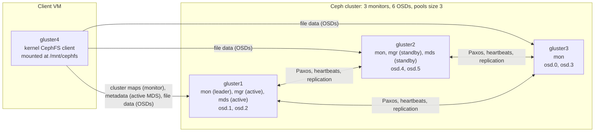

# cephfs-replicated-lab

A hands-on Ceph lab: a three-node Ceph cluster deployed with `cephadm` on the same Linux VMs and disks that ran the GlusterFS lab, with a CephFS file system mounted on a separate client. The cluster is taken through the same kinds of recorded drills as the Gluster volume (failure, disk replacement, expansion, access control, monitoring and a `fio` benchmark), and the two systems are compared from what was measured.

This is phase 2 of a storage study. Phase 1, the GlusterFS build and its nine drills, is in [glusterfs-replicated-lab](https://github.com/OB-Adams/glusterfs-replicated-lab). Its milestone 6 removed Gluster from the VMs and wiped the data disks, which is where this repository starts.

## Project status

| Item | Status |
|---|---|
| Milestone 1: deploy Ceph and mount CephFS | Complete ([docs/deploy.md](docs/deploy.md)) |
| Milestone 2: failure drills | Planned |
| Milestone 3: OSD replacement and expansion | Planned |
| Milestone 4: security and monitoring | Planned |
| Milestone 5: `fio` benchmark against the Gluster baseline | Planned |
| Milestone 6: Gluster and CephFS comparison | Planned |
| Raw evidence (session recordings) | Added in [docs/evidence](docs/evidence) |
| Screenshots | Added in [screenshots/](screenshots) |

The full tracker is in [docs/milestones.md](docs/milestones.md). Anything not listed as complete is not implemented.

## Key results

| Milestone | What happened |
|---|---|
| 1. Deploy | `HEALTH_OK` with 3 monitors, 2 managers, 2 MDS daemons and 6 OSDs on Ceph 20.2.5. A 10 MiB file's chunks traced to different placement groups, each with one copy on every server |
| 1. Deploy | gluster2's OSDs stalled for over half an hour, every attempt stopping at `osd new`, until clock skew of up to 15 s between the monitors was corrected |
| 1. Deploy | A Pacific client left on the VMs could not read the AES-256 admin key the Tentacle monitors created; Tentacle's own client needed EPEL |
| 1. Deploy | After an unattended restart of every VM, the cluster and the client's mount came back healthy by themselves |

## Objectives

- Deploy a replicated Ceph cluster and understand each layer: monitors and quorum, OSDs and BlueStore, placement groups and CRUSH, pools, the metadata server and the CephFS client.
- Repeat the Gluster lab's tests on the same hardware, so the differences come from the storage system and not the environment.
- Observe real failure and recovery behaviour instead of describing it from documentation.
- Record what was measured, what surprised me, and what remains unexplained.

## Architecture



### How it works

- The monitors hold the cluster map and agree on every change by majority (Paxos), so any two of the three keep the cluster running.
- Each OSD owns one whole disk and stores objects on it with BlueStore, with no filesystem in between.
- A client hashes an object's name to a placement group and runs CRUSH on the cluster map to find that group's three OSDs, one per host. Nothing central is asked where data lives.
- A write goes to the placement group's primary OSD, which forwards it to the other two before acknowledging, so the client sends each byte once, where a Gluster client sends it to all three bricks.
- CephFS splits files into 4 MiB objects in a data pool. The MDS serves names, directories and attributes from a metadata pool; it is not in the data path.

The concepts are explained in more depth in [docs/deploy.md](docs/deploy.md#how-ceph-is-put-together).

## Environment

| Item | Value |
|---|---|
| Hypervisor | UTM, virtualization mode (not emulation), on an Apple Silicon Mac |
| Guest architecture | aarch64 |
| Guest OS | CentOS Stream 9 |
| Ceph release | 20.2 "Tentacle": daemons from the `quay.io/ceph/ceph:v20` image (20.2.5), `cephadm` and `ceph-common` 20.2.4 from the CentOS Storage SIG |
| Extra repositories | CRB and EPEL, for libraries Tentacle's client needs |
| Servers | `gluster1`, `gluster2`, `gluster3`, 8 GB RAM each, two 10 GB data disks each (`/dev/vdb`, `/dev/vdc`) |
| Client | `gluster4`, kernel CephFS client (kernel 5.14.0-759) |
| Time | chrony on every VM, one source (`time.google.com`), `makestep 1.0 -1` |

The VMs keep their names from phase 1. The behaviour recorded here applies to this OS release and Ceph version only.

## Configuration

| Name | Value used |
|---|---|
| Daemon placement | Monitors on all three servers; managers and MDS daemons on `gluster1` and `gluster2` |
| OSD spec | [ceph/osd-spec.yml](ceph/osd-spec.yml): `/dev/vdb` and `/dev/vdc` on hosts matching `gluster[1-3]` |
| File system | `cephfs`, pools `cephfs.cephfs.meta` (16 PGs) and `cephfs.cephfs.data` (128 PGs), `size 3 min_size 2` |
| Memory limits | `osd_memory_target` 1.5 GiB with autotune off; `mds_cache_memory_limit` 1 GiB |
| Client identity | `client.gluster4`, from `ceph fs authorize cephfs client.gluster4 / rw` |
| Client files | `/etc/ceph/ceph.conf` (minimal configuration) and `/etc/ceph/ceph.client.gluster4.keyring` (mode 600) |
| Client mount | `gluster4@.cephfs=/  /mnt/cephfs  ceph  noatime,_netdev  0 0` in `/etc/fstab` |

## Installation and deployment

The procedure, with the reasoning and the fixes found during the run, is in [docs/deploy.md](docs/deploy.md#procedure). In outline:

1. On each server: remove any older Ceph repository, install Podman, LVM, chrony, `python3-jinja2` and `python3-pyyaml`, enable CRB and EPEL, install `cephadm` from the Tentacle repository, and set chrony to step the clock.
2. On `gluster1`: `cephadm bootstrap` with the host's IPv4 address, then install `ceph-common` 20.2 and set the memory limits.
3. Copy cephadm's SSH key to the other servers, add them with `ceph orch host add`, and place three monitors and two managers.
4. Apply the OSD spec.
5. `ceph fs volume create cephfs`, then `ceph fs authorize` a key for the client.
6. On `gluster4`: install `ceph-common`, copy in the configuration and key, and mount from `/etc/fstab`.

## Verification and testing

On `gluster1`:

```bash
ceph -s
ceph osd tree
ceph fs status cephfs
ceph osd pool ls detail | grep cephfs
ceph time-sync-status
```

Expected: `HEALTH_OK`; three monitors in quorum; two OSDs per host, all `up`; one active and one standby MDS; both pools `size 3 min_size 2`; every monitor's skew below 0.05.

To trace a file, write it on the client and map its objects:

```bash
printf '%x\n' $(stat -c %i /mnt/cephfs/test10M.bin)     # on gluster4: the inode in hex
rados -p cephfs.cephfs.data ls | grep "^$HEX\."          # on gluster1, with HEX set to that value
ceph osd map cephfs.cephfs.data $HEX.00000000
```

## Security considerations

- Ceph keyrings (`ceph.client.admin.keyring` and every `ceph.client.*.keyring`) are the cluster's secrets. They stay on the VMs, are excluded by `.gitignore`, and the one key printed in an error message during the deploy is replaced by `<redacted>` in the evidence.
- The client's key is limited to the `cephfs` file system and its data pools.
- Traffic between client and cluster is checksummed (`ms_mode=prefer-crc`) but not encrypted. Milestone 4 enables msgr2 secure mode.
- The lab runs as root over SSH for convenience. A real deployment should separate administrative access.

## Troubleshooting

Issues actually encountered, with causes and fixes, are in [docs/troubleshooting.md](docs/troubleshooting.md). Highlights:

| Symptom | Where it was seen |
|---|---|
| `cephadm` fails with `No module named 'jinja2'` | Milestone 1, every server |
| Bootstrap fails with `OSError: [Errno 22]` on an `fe80::` address | Milestone 1, gluster1 |
| `ceph -s` on the host: keyring `Malformed input` | Milestone 1, gluster1 |
| `nothing provides libarrow.so.900` when installing `ceph-common` 20.2 | Milestone 1, every VM |
| One host never gets its OSDs; `osd new` waits for ever | Milestone 1, gluster2 |
| `MON_CLOCK_SKEW` after the Mac slept | Milestone 1 |

## Repository structure

```text
cephfs-replicated-lab/
├── README.md
├── LICENSE
├── .gitignore
├── benchmarks/                the fio kit from phase 1, unchanged, so both systems run the same tests
│   ├── README.md
│   ├── run-bench.sh
│   ├── summarize.py
│   └── fio/                   one job file per workload
├── ceph/
│   └── osd-spec.yml           the OSD service spec applied in milestone 1
├── docs/
│   ├── deploy.md              milestone 1: concepts, procedure, results and findings
│   ├── milestones.md
│   ├── troubleshooting.md
│   └── evidence/
│       ├── deploy-session-gluster1.txt
│       ├── deploy-session-gluster2.txt
│       ├── deploy-session-gluster3.txt
│       ├── deploy-session-gluster4.txt
│       ├── verify-session-gluster1.txt
│       ├── verify-session-gluster2.txt
│       ├── verify-session-gluster3.txt
│       └── verify-session-gluster4.txt
└── screenshots/
    ├── README.md
    ├── 01-ceph-cluster-health.png
    └── 02-ceph-object-placement.png
```

## Screenshots and evidence

### The healthy cluster


### A file's objects and their OSDs


What each screenshot shows and the commands behind it are in [screenshots/README.md](screenshots/README.md). The session recordings are in [docs/evidence](docs/evidence).

## Licence

MIT. See [LICENSE](LICENSE).
